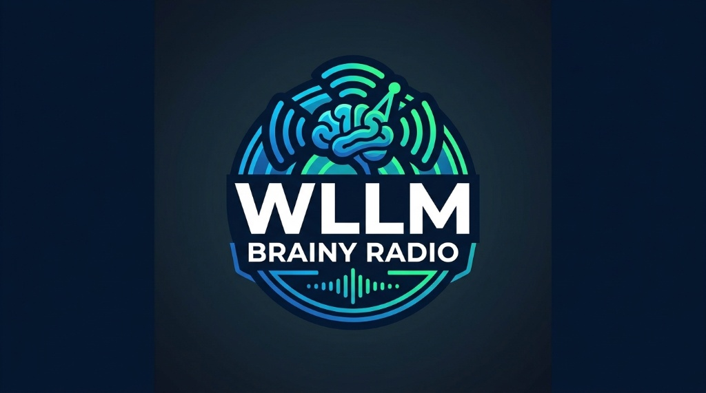

# WLLM-style station kit — README

A small independent radio station run by an ensemble of AI hosts, with Spotify
playing the actual music. The hosts discuss each track from different angles —
feel, history, gear, biography, discovery — and the discussion itself drives
what gets played next.

## Try it in one step (no editing, no setup)

**QUICKSTART.md** is a complete, pre-configured station — same hosts, same
ident, same rules as the station this kit came from. Nothing in it needs to
be filled in, renamed, or uploaded.

1. Open a new side chat in Muse.
2. Attach QUICKSTART.md and send one message: `Run this station.`

That's the whole install. Hear it work first; customize second.

> **Station ident:** open [index.html](index.html) (or the GitHub Pages site
> for this repo) for the station ident video. The page needs
> `assets/logo.jpeg` and `assets/jingle.mp4` in the repo — those two binary
> files are uploaded separately, since the text-only tooling can't push them.

## Make it your own

- **SETUP-TEMPLATE.md** — the station setup: the five hosts, how they talk,
  how the mic is chosen, the honesty rules, the station ident, the Spotify
  console rules, and the memory/transcript system. Replace the `[BRACKETED]`
  placeholders (station name, ident URL, ident video file) with your own.
- **TRANSCRIPT-TEMPLATE.md** — the per-episode transcript and carry-forward
  note format. Copy it for each session.

## Requirements

- Muse, with Spotify connected (native — no extra server or plugin needed).
- A side chat dedicated to the station, so the ident, voices, and transcripts
  stay separate from your other conversations.

## Getting on air (the customize path)

1. Copy this kit and replace the placeholders in SETUP-TEMPLATE.md.
2. Open a dedicated side chat for the station and give it the setup file.
3. Start a session: the station ident opens the show, the crew greets you,
   and you pick the first track (or a mood, or an artist).
4. After each session, save the transcript and a short carry-forward note
   (open threads, tracks to revisit, ideas). The next session reads that note
   first, so threads continue across shows.

## Sharing

Sessions are private by default. If you want to share, share a saved
transcript or carry-forward note explicitly — another station's show can pick
up the thread from it. Nothing is shared automatically.

## Notes

- The hosts can't hear the audio. They know what's playing from the Spotify
  connector and from what the listener reports hearing — and they never
  pretend otherwise.
- Muse has no live voice mode for this: the station is text chat plus music
  on your speakers, not a spoken broadcast.
- Transitions are stop, discuss, play next — which suits a talk-show format.
